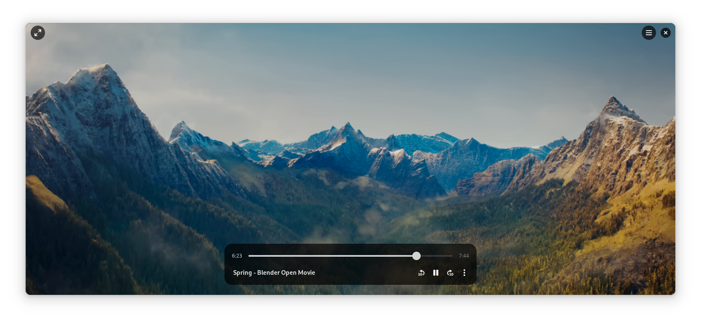

  

  # Video Player

  Watch without distraction

  

This is the development repository for "Video Player", project name Showtime.
For general information about the app see https://apps.gnome.org/Showtime/.

## Features

- Plays a single video in a borderless window
- Supports subtitles and different playback speeds
- Optionally resumes playback from where you last left off
- Supports running from a file manager, or the command-line via `showtime`

## Contributing

The project follows the [GNOME Code of Conduct](https://conduct.gnome.org/).

We do not accept AI-generated contributions.

This is a GStreamer-based video player, with an interface that follows the [GNOME HIG](https://developer.gnome.org/hig/).
It is written in Python and utilizes GTK4 with [libadwaita](https://gitlab.gnome.org/GNOME/libadwaita/).

Useful tutorials and links:
### Tutorials, References

- https://welcome.gnome.org/
- https://welcome.gnome.org/app/Showtime/
- https://pygobject.gnome.org/tutorials/index.html
- [GstPlay](https://gstreamer.freedesktop.org/documentation/play/gstplay.html?gi-language=python),
  a GStreamer library for playback.
- [Commit message format guide](https://handbook.gnome.org/development/commit-messages.html)
